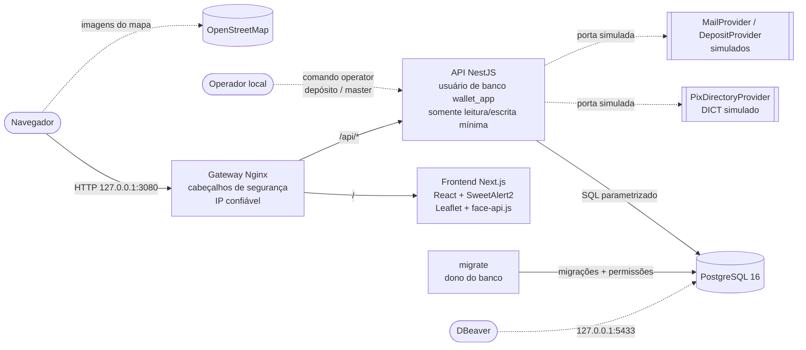
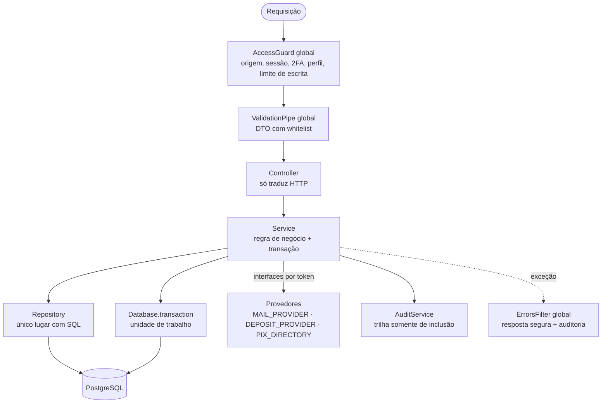
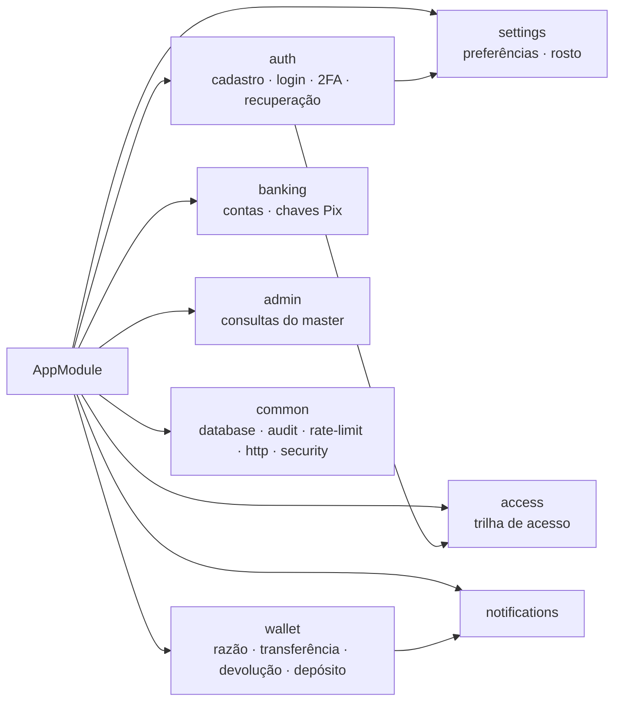
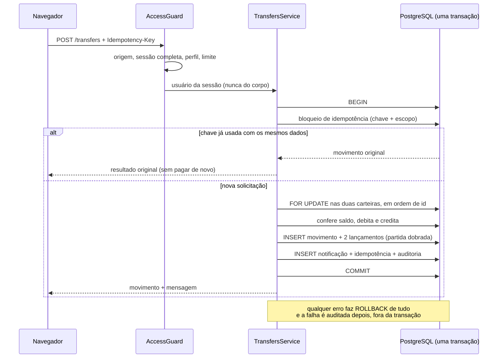
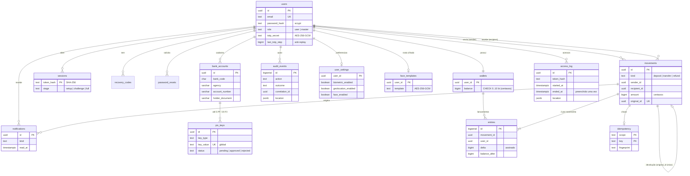

# Arquitetura e decisões

```text
Navegador → localhost:3080 / Nginx
                         ├── /       → Next.js (frontend)
                         └── /api/*  → NestJS → PostgreSQL
Operador local → comando controlado de depósito / provisionamento master
```

Gateway e PostgreSQL publicam portas limitadas a 127.0.0.1: 3080 para a aplicação e 5433 para acesso local pelo DBeaver. API e frontend usam apenas rede Docker privada. O gateway sobrescreve o cabeçalho de IP encaminhado, e a API confia em um único proxy. Em Docker Desktop, NAT pode fazer o IP observado corresponder ao intermediário local; ele não deve ser apresentado como identificação inequívoca de um telefone.

## Diagramas

### 1. Containers (Docker Compose)



Só o gateway e o PostgreSQL (para o DBeaver) publicam portas, ambos em `127.0.0.1`. A API conecta como `wallet_app`, que não altera o esquema nem o histórico; as migrações rodam em um container separado com o dono do banco. Linhas tracejadas são integrações opcionais ou simuladas.

### 2. Camadas do backend





### 3. Transferência (consistência e reversão)



A devolução é um **novo** movimento ligado ao original (`UNIQUE(original_id)`); nada é apagado nem editado.

### 4. Modelo de dados



`movements`, `entries` e `audit_events` são imutáveis (gatilhos + permissões); `access_log` só aceita o preenchimento único do encerramento. `rate_limits` (limite de tentativas) não tem relação com as demais e foi omitida do diagrama.

## Frontend (Next.js, App Router)

Cada item do menu é uma **rota com URL própria**, então o F5 mantém a página, o botão "voltar" funciona e é possível abrir um endereço direto.

```text
frontend/app
├── layout.tsx            raiz: estilos, aviso de demonstração e SessionProvider
├── page.tsx              "/"  entrada: login, cadastro, recuperação de senha e 2FA
├── session.tsx           contexto da sessão (usuário, estágio, ocupado, sino) + useSession()
├── api.ts                único ponto de saída para a API (cookie, CSRF, idempotência)
├── alerts.ts             SweetAlert2 (notify, confirmAction, askInput)
├── (app)/                grupo das páginas autenticadas (não aparece na URL)
│   ├── layout.tsx        sidebar, barra superior, sino e códigos de recuperação
│   ├── carteira/         /carteira        saldo, adicionar saldo, transferência, extrato
│   ├── relatorios/       /relatorios      relatórios: indicadores, gráficos e sugestões (página inicial do cliente)
│   ├── notificacoes/     /notificacoes    avisos não lidos
│   ├── perfil/           /perfil/bancario · /perfil/seguranca · /perfil/acessos
│   ├── seguranca/        /seguranca       troca do autenticador
│   ├── sobre/            /sobre
│   ├── contas/           /contas          (master) busca de contas e extrato
│   ├── eventos/          /eventos         (master) trilha de auditoria, aceita ?userId=
│   └── monitoramento/    /monitoramento   (master) indicadores e conciliação
├── components/           ui (Field, Pager...), Transactions, AuditRow
├── lib/                  types, format (R$, datas, centavos), locate (geolocalização)
└── profile/              BankTab, SecurityTab, AccessTab, FaceFlow/FaceCapture, mapas Leaflet
```

- **Sessão compartilhada:** o `SessionProvider` consulta `/auth/status` uma vez ao abrir qualquer URL; as páginas leem o usuário com `useSession()`. O envelope `work()` (ocupado + try/catch + finally) é o equivalente, no navegador, do `try/catch` do backend.
- **Guarda de rota no cliente é só conforto:** sem sessão, o layout volta para `/`; perfil errado vai para a própria página inicial (cliente em `/relatorios`, master em `/contas`). Quem recusa de verdade é o `AccessGuard` do servidor, qualquer que seja a tela.
- **Responsabilidade única por arquivo:** cada página carrega só os próprios dados ao montar; componentes compartilhados (`Transactions`, `AuditRow`) recebem tudo por props.

## Separação de responsabilidades

O backend é um monólito modular NestJS. Cada módulo tem controlador (HTTP), serviços (regras), repositórios (SQL) e DTOs (contrato de entrada):

```text
backend/src
├── main.ts / app.module.ts     inicialização e composição; guard, filtro e pipe globais
├── operator.ts / migrate.ts    comandos locais (depósito, master) e migrações
├── common/
│   ├── database/               Database: pool e transação (unidade de trabalho)
│   ├── audit/                  AuditService + AuditRepository (trilha somente de inclusão)
│   ├── rate-limit/             RateLimiter + repositório (janela fixa no PostgreSQL)
│   ├── http/                   AccessGuard, ErrorsFilter, decoradores de acesso, logger de requisições
│   ├── dto/                    campos reutilizáveis e ValidationPipe
│   └── security/               crypto (scrypt, AES-GCM, TOTP) e validadores
├── notifications/              NotificationsService + repositório (avisos de transferência/devolução recebidas)
├── banking/                    BankingService + repositório (contas, chaves Pix), regras de formato (pix-key.rules),
│                               porta PixDirectoryProvider (DICT simulado)
├── settings/                   SettingsService (biometria, geolocalização), FaceService (rosto cifrado, comparação)
├── access/                     AccessService + AccessLogRepository (trilha de acesso: login, logout, duração, local)
├── insights/                   InsightsService + repositório (agregações SQL do BI) + insights.rules (sugestões)
├── users/                      UsersRepository
├── auth/                       AuthService, TwoFactorService, PasswordRecoveryService,
│                               repositórios de sessão/códigos/redefinição, MailProvider
├── wallet/                     LedgerService (partida dobrada), IdempotencyService,
│                               TransfersService (transferir/devolver), DepositsService,
│                               WalletService (saldo/extrato), DepositProvider
├── admin/                      AdminService + AdminRepository (leituras do master)
└── health/                     /api/health
```

Decisões e princípios:

- **Camadas:** o controlador só traduz HTTP; o serviço aplica a regra de negócio e define a transação; o repositório é o único lugar com SQL. Isso permite testar as regras com repositórios em memória (`test/helpers/memory.mjs`), sem banco.
- **Responsabilidade única:** o razão (`LedgerService`) só lança partidas e valida saldo; idempotência, transferência, depósito e consulta são serviços distintos; `AuthService`, `TwoFactorService` e `PasswordRecoveryService` separam login, segundo fator e recuperação.
- **Inversão de dependência:** serviços dependem de interfaces ligadas por token (`MAIL_PROVIDER`, `DEPOSIT_PROVIDER`). Trocar o provedor simulado por um real é mudar uma linha no módulo, sem tocar nas regras. Um provedor real ainda exigirá contrato, confirmação autenticada e conciliação.
- **Acesso declarativo:** `@Access("public" | "any-stage" | "partial")` e `@Roles(...)` nas rotas, aplicados por um único `AccessGuard`. Sem decorador, a rota exige sessão completa com 2FA; o master é barrado nas rotas de usuário e vice-versa.
- **Entrada validada por DTO:** `class-validator` com `whitelist` e `forbidNonWhitelisted`; um campo desconhecido (como `role`) derruba a requisição em vez de ser ignorado.
- **Padrões usados:** repositório, unidade de trabalho (transação), estratégia/adaptador (provedores), idempotência por chave e impressão digital, guard e filtro de exceções do Nest.
- **Tratamento de erros em camadas:** `Database.transaction` faz `try/catch` com ROLLBACK e preserva o erro original mesmo que o rollback falhe (a conexão quebrada é descartada); `TransfersService` e `DepositsService` capturam falhas inesperadas, registram uma linha estruturada (`logUnexpected`, sem dados pessoais) e relançam, e uma queda do provedor de depósito vira 503 sem creditar nada; `ErrorsFilter` global é a última barreira: recusas de negócio mantêm a mensagem, o restante vira um 500 genérico e tudo é auditado. Não se repete `try/catch` em cada controlador: o filtro global cumpre esse papel em um único lugar.
- **Saldo inicial pelo usuário:** `DepositsService` tem duas portas de entrada sobre o mesmo caminho interno (`credit`): o comando do operador e `selfDeposit`, usado por `POST /deposits`. O usuário só credita a própria carteira (id da sessão, nunca do corpo), com teto de R$ 10.000,00 por operação, 20 adições por hora, idempotência em escopo próprio de cada usuário e auditoria com a origem (`self-service`). O dinheiro continua entrando só como movimento `deposit`, então a conciliação (soma dos saldos = soma dos depósitos) segue válida. É um recurso de demonstração, ligado por `DEMO_DEPOSITS`: com dinheiro real, quem confirma o pagamento é o provedor.
- **Notificações:** o destinatário de uma transferência e quem enviou a transferência original de uma devolução recebem um aviso. O aviso é criado NA MESMA transação do movimento (`NotificationsService.create`): se houver rollback, o aviso some junto, e uma repetição por idempotência não cria outro (`UNIQUE(user_id, movement_id)`). A tabela `notifications` é a única do domínio financeiro com UPDATE permitido à API, pois marcar como lida grava `read_at`; os movimentos continuam imutáveis. A listagem mostra só as NÃO lidas (índice parcial), então ao ler o aviso some. Cada usuário lê e altera apenas os próprios avisos (404 igual para inexistente e alheio). O frontend consulta `GET /notifications/count` a cada 15 s e ao voltar à aba, acende o sino e mostra um toast quando o número aumenta.
- **Perfil, dados bancários e Pix:** contas e chaves são cadastro do usuário (não razão financeiro), por isso a API pode alterá-las; toda consulta filtra pelo usuário da sessão e um id alheio devolve 404. O formato da chave é validado por funções puras (`pix-key.rules.ts`: dígitos verificadores de CPF/CNPJ, celular `+55`, e-mail, chave aleatória gerada no servidor). `UNIQUE(key_value)` é global: a chave existe em uma só conta, como no DICT, o que também a impede de repetir dentro de um banco; a corrida entre dois cadastros é decidida pela restrição do banco (23505 vira 409). O limite de chaves (5 PF, 20 PJ) é conferido com a conta bloqueada (`FOR UPDATE`). O "registro no Banco Central" é uma SIMULAÇÃO atrás da interface `PixDirectoryProvider` (e-mail e celular exigem código de posse, guardado só como hash, 5 tentativas, 10 minutos); trocar pelo DICT real é mudar uma linha no módulo. Toda chave pertence a uma conta bancária cadastrada do usuário (`bank_account_id NOT NULL`, `ON DELETE CASCADE`). A edição reaplica as regras do cadastro e reinicia a aprovação (e-mail e celular pedem novo código); relê a chave com bloqueio antes de gravar. As máscaras de CPF, CNPJ e celular são só da interface; o servidor remove a pontuação e valida de novo.
- **Reconhecimento facial:** o navegador (face-api.js, arquivos servidos pelo próprio site, sem serviço externo) detecta o rosto, exige a prova de vida (direita, esquerda, abaixar, levantar, sorrir) e produz um vetor de 128 números; só ele sai do aparelho. O servidor o cifra (AES-256-GCM, mesma chave do 2FA) e compara por distância euclidiana (limite 0,5). Ativar e desativar pedem a senha. Na recuperação de senha o rosto SOMA-se ao link do e-mail e não o substitui: a prova de vida roda no navegador, que o atacante controla, então sozinha ela não sustenta a recuperação. Uma recusa desfaz a transação e o link continua valendo, mas as tentativas são limitadas (5 por 15 min) e auditadas fora da transação (um INSERT de auditoria dentro dela esperaria o bloqueio do usuário). Biometria do aparelho é apenas um sinalizador para o aplicativo móvel.
- **Trilha de acesso:** a tabela `access_log` recebe um registro por login completo, na mesma transação que cria a sessão. O gatilho só permite preencher `ended_at`/`end_reason` uma vez; nada se reescreve nem se apaga. O encerramento é gravado no próprio comando que apaga a sessão (logout, troca de senha/autenticador, limite de 5 sessões) e, para sessões que apenas venceram, a consulta já as mostra como encerradas no instante do vencimento (sem escrever) e a linha é fechada de fato no próximo login. A duração é `ended_at - started_at` (ou até agora, se aberta). Com a geolocalização desligada, o servidor descarta a localização recebida (`status: disabled`).
- **Mapas:** Leaflet com OpenStreetMap, um mapa por acesso (marcador, círculo de precisão e tooltip com data `dd/mm/yyyy h:mm:ss`) e um mapa geral. Tudo que vem do cliente (IP, aparelho) é escapado antes de entrar no tooltip. A geolocalização é pedida com alta precisão (GPS/Wi-Fi) e sem cache.
- **BI e sugestões:** `GET /insights` agrega o razão (`entries`) do usuário da sessão em SQL (totais por tipo e sentido, série por dia/semana/mês com o saldo ao fim de cada intervalo, principais contrapartes) e a regra `buildSuggestions`, uma função pura, transforma os números em sugestões (saídas acima das entradas, fôlego do saldo em dias, concentração em uma pessoa, saída atípica, devoluções). Fica em página própria, "Relatórios" (`/relatorios`), separada de "Minha carteira"; o período é uma lista fechada (30, 90, 365 dias) e o agrupamento do SQL só recebe valores escolhidos no servidor. Os gráficos são SVG puro, com `role="img"`, tooltips e tabela alternativa. As sugestões são orientações automáticas sobre dados simulados, não aconselhamento financeiro.
- **Mensagens de retorno:** as rotas que movem dinheiro devolvem o movimento mais um `message` em português, definido no servidor; erros também trazem `message` e `correlationId`.
- **Comentários:** classes e métodos com regra não óbvia têm comentário JSDoc explicando o porquê (bloqueios, idempotência, segurança), não o que o código já diz.
- **Mensagens ao usuário:** o frontend centraliza avisos em `frontend/app/alerts.ts` (SweetAlert2): confirmação antes de transferir e de devolver, notificação de sucesso e modal de erro com a mensagem segura devolvida pela API.
- SQL parametrizado torna os bloqueios e limites transacionais explícitos; um backend único reduz a complexidade operacional do desafio.

## Consistência financeira

Centavos inteiros, restrições no banco, carteira sem saldo negativo e limite de R$ 10 bilhões por carteira/operação. Os limites são de demonstração, não de política bancária real.

Transferência bloqueia as carteiras em ordem de UUID, debita, credita, insere movimentação, lançamentos, chave de idempotência e auditoria na mesma transação. Qualquer falha desfaz tudo. Falhas e recusas são auditadas separadamente após o rollback.

Requisições repetidas são serializadas por chave de idempotência e escopo. Devoluções são também serializadas pelo ID da transferência original, sem exigir permissão de alteração do histórico. Uma restrição única impede duas devoluções da mesma transferência. Não se apagam nem se editam registros financeiros para representar estorno.

## Autenticação e autorização

- Senhas derivadas com scrypt e salt individual.
- TOTP de 6 dígitos, período de 30 segundos, tolerância de um período e bloqueio de reutilização do contador aceito.
- Segredo TOTP cifrado com AES-256-GCM; chave externa ao código.
- Oito códigos de recuperação de uso único, guardados como hashes e exibidos somente na ativação.
- Sessões opacas aleatórias; apenas hashes ficam no banco. Etapa parcial expira em 10 minutos; completa em 8 horas.
- No máximo 5 sessões completas simultâneas por usuário; ao entrar uma nova, as mais antigas são revogadas. Não há tela para listar ou encerrar sessões individualmente.
- Cookies HttpOnly e SameSite=Strict; POST exige origem permitida e cabeçalho específico.
- Limites persistidos no PostgreSQL: login, segundo fator, cadastro e operações autenticadas. No login e no 2FA só as FALHAS contam (`guard`/`fail`/`reset`): acertar a senha zera o contador, e o contador da conta é por e-mail + IP, então quem erra a senha alheia tranca só o próprio IP, não o dono. Um teto global por e-mail (100 falhas) cobre o ataque distribuído. Repetir um código TOTP legítimo já usado não conta como falha.
- Cadastro não recebe perfil; master nasce exclusivamente no provisionamento local e também exige 2FA.
- Recuperação de senha: token aleatório de 256 bits, válido por 7 minutos, de uso único (`DELETE ... RETURNING`); só o hash fica no banco e um novo pedido invalida o anterior. A resposta ao pedido é igual para contas existentes ou não, com limite por IP e por e-mail. O token viaja no fragmento da URL (não vai ao servidor nem a logs de acesso) e é removido da barra de endereço ao ser lido. Redefinir a senha encerra todas as sessões e não desativa o 2FA. O envio é simulado (`DEMO_MAIL=true` escreve o link no log da API); um provedor real implementaria `MailProvider`.
- Troca do autenticador exige senha e segundo fator/recuperação, revoga todas as sessões e bloqueia operações até a nova ativação.

## Auditoria e localização

Eventos contêm autor quando identificado, recurso, data do servidor, resultado, motivo, correlação, IP, navegador e localização quando disponível. Tentativas de login com conta conhecida são associadas ao recurso da conta, mesmo sem autor autenticado. Consultas do master também são registradas. Como a trilha é somente de inclusão, o ruído anônimo (rotas inexistentes, e-mails desconhecidos) tem orçamento de 100 eventos por IP a cada 15 minutos; o excedente vira uma linha `audit.suppressed` no log, sem dados pessoais. Eventos de conta conhecida ou de usuário autenticado nunca são descartados. A consulta de saldo não gera evento; o extrato, sim.

A credencial do serviço não tem UPDATE/DELETE em auditoria, movimentações ou lançamentos. Gatilhos também recusam mutações do histórico. Isso protege contra alterações pela aplicação, mas não constitui armazenamento inviolável contra um administrador do banco com poder de alterar o esquema.

Senha, token, códigos TOTP, chaves de recuperação e segredo do autenticador não entram nos logs. Localização é contextual, validada quanto ao formato e não verificada quanto à veracidade. Na área do master a visualização usa grade geográfica local. Na página de perfil do usuário os mapas usam o OpenStreetMap: nossas rotas não enviam coordenadas a ele, mas o navegador pede as imagens da região ao serviço, que pode inferir a área consultada.

Política desta demonstração: usar dados fictícios; manter dados somente durante o período de avaliação, com prazo operacional máximo proposto de 30 dias. A remoção ao encerrar a demonstração exige procedimento explícito do responsável sobre o volume, pois a aplicação não permite apagar a trilha. Não há expurgo automático implementado. Produção exige política própria de retenção, controles de acesso, backup, gestão de chaves e operação.

## Banco, imagens e gateway: decisões de desempenho e endurecimento

- **Índice do extrato:** `entries(user_id, id DESC)` (migração 005). O extrato e os relatórios filtram os lançamentos de um usuário; sem o índice a consulta varria a tabela inteira, que cresce com todos os movimentos do sistema.
- **Limpeza do limite de tentativas:** as janelas vencidas de `rate_limits` são apagadas de forma oportunista (em média a cada 200 contagens, apoiada no índice em `expires_at`), sem agendador. Uma falha na limpeza nunca afeta a requisição.
- **Imagem de produção sem testes:** o `Dockerfile` da API tem o estágio `runtime` (só código compilado, dependências de execução e migrações) e o estágio `test` (runtime + `test/`), usado apenas pelo perfil `test` do compose.
- **Frontend somente leitura:** o container `web` roda com sistema de arquivos `read_only`, `tmpfs` em `/tmp`, sem capacidades Linux e sem novos privilégios, como a API.
- **CSP no gateway:** o HTML do Next sai com `Content-Security-Policy` restrita (`default-src 'self'`, sem `object`, sem frames, tiles só do OpenStreetMap). `'unsafe-inline'` permanece em script/style por causa da hidratação do Next e de Leaflet/SweetAlert2; trocar por nonce exigiria renderização dinâmica. HSTS não é enviado em HTTP; deve ser ligado junto com o HTTPS.

## Correções da revisão de código

- **Respostas que não revelam contas:** o cadastro devolve a mesma resposta para e-mail novo e já cadastrado; o pedido de link de senha tem duração mínima fixa (300 ms) e o e-mail sai fora da requisição, então nem o corpo nem o tempo distinguem os dois casos.
- **Tentativas do código Pix:** o contador é gravado na mesma transação que trava a chave, então palpites simultâneos entram em fila e o teto de 5 vale de verdade.
- **Rosto na redefinição:** o limite de tentativas é contado antes de abrir a transação (outra conexão do pool), evitando esgotar o pool com várias redefinições simultâneas.
- **Leituras não escrevem:** a trilha de acesso calcula o encerramento por vencimento na própria consulta (`EFFECTIVE_END`) e a linha é fechada de fato no próximo login; `POST /auth/setup` substitui o GET que criava o segredo.
- **Erros com código estável:** a API envia `code` (ex.: `session_expired`) nos 401 de sessão, e o frontend decide com ele, não com o texto da mensagem.
- **TOTP (RFC 6238, 5.2):** um código do próximo intervalo é aceito e grava esse intervalo; o do intervalo atual só volta a valer quando ele chegar. É o preço de impedir a repetição de um código espiado, e a repetição não gasta o limite de falhas.
- **Um documento, um usuário:** o CPF/CNPJ do titular passa a ser único por usuário e por pessoa (o primeiro a cadastrá-lo), o que impede de declarar o CPF de outra pessoa em uma segunda conta. A prova de que o documento é mesmo do usuário é o KYC do onboarding, que esta demonstração não tem.

## Limitações deliberadas

- Não movimenta dinheiro real, não integra bancos e não oferece saques.
- HTTP e cookie sem Secure somente no localhost; publicação externa exige HTTPS, cookie Secure e origens/rede configuradas. A geolocalização em celular exige contexto seguro e acesso de rede próprio, não disponível nesta configuração local.
- Monitoramento é um painel consultado sob demanda, com healthchecks e logs. Alertas visuais surgem a partir de 5 recusas/falhas em 15 minutos ou divergência de conciliação; não há envio de notificações.
- A grade do master mostra latitude/longitude e precisão, sem mapa de ruas; os mapas do perfil dependem do OpenStreetMap (internet) e continuam sem identificar fisicamente o dispositivo.
- O registro de chaves Pix é simulado (sem DICT nem credenciamento no Banco Central) e o catálogo de bancos é fixo. O reconhecimento facial tem a prova de vida no navegador e só é aceito junto com o link do e-mail; produção pediria o SDK biométrico do aplicativo ou um serviço certificado.
- A senha pode ser redefinida por link de 7 minutos, mas o e-mail é simulado (o link aparece no log da API com `DEMO_MAIL=true`; não deve ficar ativo fora da demonstração). A perda do autenticador depende de um código de reserva; não há desativação de 2FA nem recuperação por SMS.
- As credenciais iniciais ficam nos arquivos locais ignorados pelo Git; o responsável deve protegê-los e controlar o acesso ao Docker.

## Evolução para dinheiro real

Integrar com banco/provedor habilitado, definir modelo de contas e recursos, confirmar pagamentos por notificações autenticadas, conciliar saldos externos e internos e tratar operações pendentes. A transação local não reverte automaticamente uma operação externa já liquidada. Essa evolução não está implementada.
