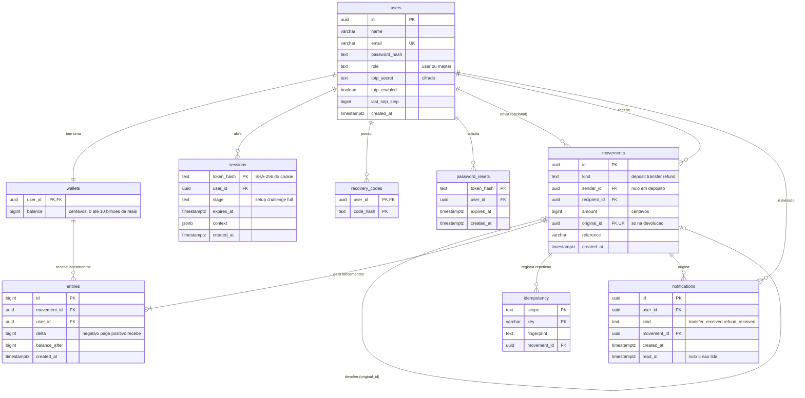
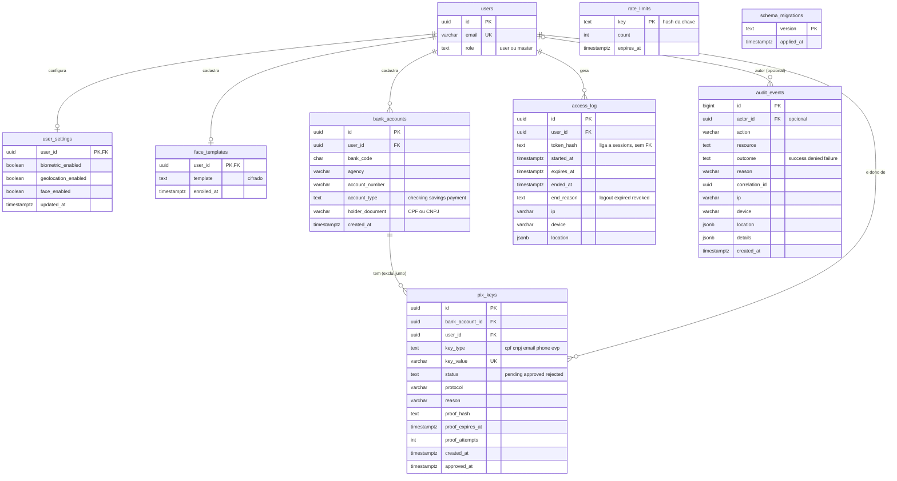
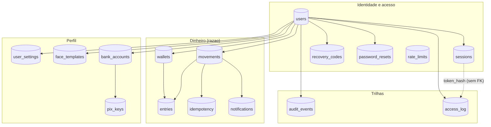
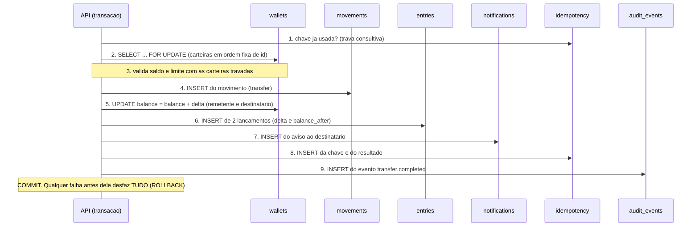
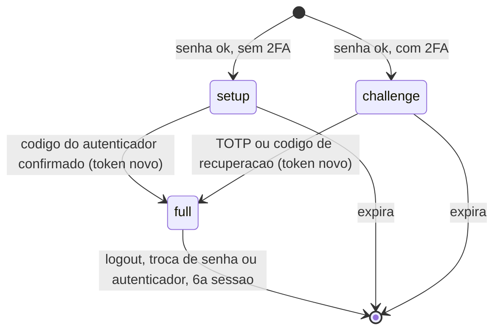
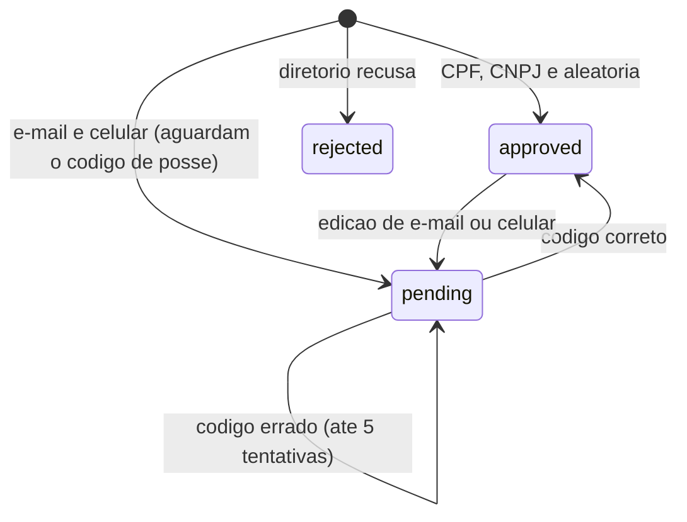
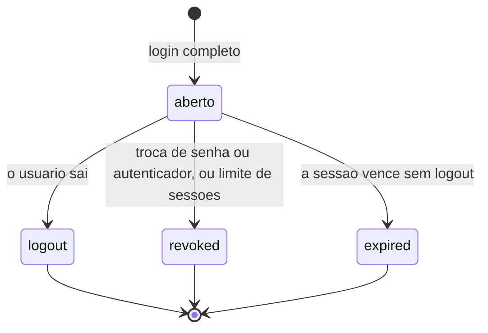

# Banco de dados

PostgreSQL 16. O esquema é criado por migrações SQL versionadas (`backend/migrations/`) e foi conferido contra o banco em execução. Este documento descreve as tabelas, os relacionamentos, as regras que o próprio banco impõe e as permissões da aplicação.

- [1. Princípios de projeto](#1-princípios-de-projeto)
- [2. Diagramas entidade-relacionamento](#2-diagramas-entidade-relacionamento)
- [3. Visão por domínio](#3-visão-por-domínio)
- [4. Relacionamentos](#4-relacionamentos)
- [5. Dicionário de dados](#5-dicionário-de-dados)
- [6. Regras impostas pelo banco](#6-regras-impostas-pelo-banco)
- [7. Índices](#7-índices)
- [8. Permissões e imutabilidade](#8-permissões-e-imutabilidade)
- [9. Como uma operação grava os dados](#9-como-uma-operação-grava-os-dados)
- [10. Estados e ciclos de vida](#10-estados-e-ciclos-de-vida)
- [11. Dados sensíveis](#11-dados-sensíveis)
- [12. Migrações](#12-migrações)
- [13. Consultas úteis](#13-consultas-úteis)

## 1. Princípios de projeto

1. **Dinheiro em centavos inteiros** (`bigint`). Nunca `float` nem `numeric` com casas decimais: `0,1 + 0,2` não é exato em ponto flutuante, e saldo não pode ter erro de arredondamento.
2. **Histórico imutável.** `movements`, `entries` e `audit_events` só aceitam inclusão. Um estorno é um **novo** movimento ligado ao original; nada é editado nem apagado.
3. **Razão de partida dobrada.** Cada movimento gera um lançamento (`entries`) por carteira afetada. O saldo guardado em `wallets` é um cache que tem de bater com a soma dos lançamentos (é o que a conciliação confere).
4. **Defesa em profundidade.** As regras mais críticas (saldo nunca negativo, valores positivos, tipos válidos, uma devolução por transferência) são `CHECK`, `UNIQUE` e gatilhos no banco. Mesmo um bug na aplicação não grava dado inválido.
5. **Menor privilégio.** A API conecta como `wallet_app`, sem permissão de alterar esquema nem de atualizar ou apagar o histórico. As migrações rodam em um container separado, com o dono do banco.
6. **Segredos nunca em claro.** Senhas com scrypt, tokens e códigos só como hash SHA-256, e segredos do 2FA e modelo facial cifrados (AES-256-GCM, com chave fora do banco).
7. **Identificadores não sequenciais.** `uuid` nas entidades expostas (não adivinháveis). `bigserial` só nas tabelas internas de ordem (`entries`, `audit_events`).

## 2. Diagramas entidade-relacionamento

As 16 tabelas e todas as chaves estrangeiras reais, em dois diagramas para ficarem legíveis. `users` aparece nos dois. `rate_limits` e `schema_migrations` não se ligam a nenhuma tabela.

Todos os diagramas deste documento também existem como imagens PNG em alta resolução, em [`docs/diagramas-banco/`](diagramas-banco/), para inserir em Word, slides ou outros documentos.

### 2.1 Identidade, acesso e dinheiro



### 2.2 Perfil e trilhas



> `access_log.token_hash` aponta para `sessions.token_hash` **logicamente**, sem chave estrangeira: a sessão é apagada no logout, e o registro de acesso precisa continuar.

## 3. Visão por domínio

As 16 tabelas se organizam em quatro grupos. A tabela `users` é o centro.



## 4. Relacionamentos

Todas as chaves estrangeiras são `ON DELETE NO ACTION`, exceto `pix_keys.bank_account_id` (`CASCADE`). A aplicação não apaga usuários, movimentos nem lançamentos.

| De | Para | Cardinalidade | Significado |
|---|---|---|---|
| `wallets.user_id` | `users` | 1 : 1 | Cada usuário tem exatamente uma carteira, criada na mesma transação do cadastro. |
| `sessions.user_id` | `users` | N : 1 | Um usuário tem várias sessões (no máximo 5 completas). |
| `recovery_codes.user_id` | `users` | N : 1 | 8 códigos de recuperação de uso único por usuário. |
| `password_resets.user_id` | `users` | N : 1 | Links de redefinição de senha (um novo pedido invalida o anterior). |
| `user_settings.user_id` | `users` | 1 : 0..1 | Preferências de segurança. |
| `face_templates.user_id` | `users` | 1 : 0..1 | Modelo facial cifrado. |
| `bank_accounts.user_id` | `users` | N : 1 | Várias contas bancárias por usuário. |
| `pix_keys.bank_account_id` | `bank_accounts` | N : 1 | Toda chave pertence a uma conta; apagar a conta apaga as chaves (`CASCADE`). |
| `pix_keys.user_id` | `users` | N : 1 | Dono da chave (todas as consultas filtram por ele). |
| `access_log.user_id` | `users` | N : 1 | Um registro por login completo. |
| `audit_events.actor_id` | `users` | N : 0..1 | Autor do evento; nulo quando não há autor identificado. |
| `movements.sender_id` | `users` | N : 0..1 | Remetente; nulo em depósito. |
| `movements.recipient_id` | `users` | N : 1 | Destinatário. |
| `movements.original_id` | `movements` | 1 : 0..1 | Aponta a transferência devolvida. `UNIQUE` garante **uma só devolução** por transferência. |
| `entries.movement_id` | `movements` | N : 1 | De 1 a 2 lançamentos por movimento. |
| `entries.user_id` | `wallets` | N : 1 | Carteira afetada pelo lançamento. |
| `idempotency.movement_id` | `movements` | N : 1 | Resultado guardado de uma requisição repetível. |
| `notifications.user_id` | `users` | N : 1 | Quem é avisado. |
| `notifications.movement_id` | `movements` | N : 1 | Movimento que originou o aviso. |

## 5. Dicionário de dados

Tipos abreviados: `ts` = `timestamptz`, `vc(n)` = `varchar(n)`. "Obrig." indica `NOT NULL`.

### 5.1 Identidade e acesso

**`users`**: contas de clientes e do auditor.

| Coluna | Tipo | Obrig. | Descrição |
|---|---|---|---|
| `id` | uuid | sim | Chave primária. |
| `name` | vc(100) | sim | Nome. |
| `email` | vc(254) | sim | **Único**. Identifica o destinatário em transferências. |
| `password_hash` | text | sim | scrypt com salt individual (`salt:hash`). |
| `role` | text | sim | `user` ou `master`. Padrão `user`; o master só nasce pelo comando local do operador. |
| `totp_secret` | text | não | Segredo do autenticador, **cifrado**. |
| `totp_enabled` | boolean | sim | Verdadeiro só depois de confirmar o primeiro código. |
| `last_totp_step` | bigint | sim | Último intervalo de 30 s aceito (impede reutilizar o código). Padrão -1. |
| `created_at` | ts | sim | Criação. |

**`wallets`**: saldo atual (cache do razão).

| Coluna | Tipo | Obrig. | Descrição |
|---|---|---|---|
| `user_id` | uuid | sim | PK e FK para `users`. |
| `balance` | bigint | sim | Centavos. `CHECK` entre 0 e 1.000.000.000.000. |

**`sessions`**: sessões no servidor.

| Coluna | Tipo | Obrig. | Descrição |
|---|---|---|---|
| `token_hash` | text | sim | PK. SHA-256 do token do cookie (o token em si nunca é guardado). |
| `user_id` | uuid | sim | FK. |
| `stage` | text | sim | `setup`, `challenge` ou `full`. |
| `expires_at` | ts | sim | Validade, calculada com o relógio do banco. |
| `context` | jsonb | sim | IP, aparelho e localização do início do login. |
| `created_at` | ts | sim | Criação. |

**`recovery_codes`**: PK composta (`user_id`, `code_hash`). Só o hash do código; a linha é apagada ao usar.

**`password_resets`**: `token_hash` (PK), `user_id`, `expires_at` (7 minutos), `created_at`. Só o hash do token; a linha é apagada ao usar.

**`rate_limits`**: `key` (PK, hash), `count`, `expires_at`. Limite de tentativas por janela, no banco para valer entre reinícios e instâncias. As janelas vencidas são limpas periodicamente.

### 5.2 Dinheiro

**`movements`**: o livro de tudo que moveu dinheiro. Imutável.

| Coluna | Tipo | Obrig. | Descrição |
|---|---|---|---|
| `id` | uuid | sim | PK. |
| `kind` | text | sim | `deposit`, `transfer` ou `refund`. |
| `sender_id` | uuid | não | FK. Nulo só em depósito. |
| `recipient_id` | uuid | sim | FK. |
| `amount` | bigint | sim | Centavos, entre 1 e 1.000.000.000.000. |
| `original_id` | uuid | não | FK para `movements`, **único**. Só em `refund`. |
| `reference` | vc(160) | não | Referência do provedor, nos depósitos. |
| `created_at` | ts | sim | Criação. |

**`entries`**: lançamentos (partida dobrada). Imutável.

| Coluna | Tipo | Obrig. | Descrição |
|---|---|---|---|
| `id` | bigserial | sim | PK; ordem de gravação, usada no extrato. |
| `movement_id` | uuid | sim | FK. |
| `user_id` | uuid | sim | FK para `wallets`. |
| `delta` | bigint | sim | Valor com sinal: negativo em quem paga, positivo em quem recebe. Nunca zero. |
| `balance_after` | bigint | sim | Saldo da carteira depois do lançamento (nunca negativo). |
| `created_at` | ts | sim | Criação. |

**`idempotency`**: PK composta (`scope`, `key`), com `fingerprint` (hash dos dados do pedido) e `movement_id`. Repetir a mesma chave com os mesmos dados devolve o movimento original; com dados diferentes, a API responde 409.

**`notifications`**: avisos de dinheiro recebido.

| Coluna | Tipo | Obrig. | Descrição |
|---|---|---|---|
| `id` | uuid | sim | PK. |
| `user_id` | uuid | sim | FK. Quem é avisado. |
| `kind` | text | sim | `transfer_received` ou `refund_received`. |
| `movement_id` | uuid | sim | FK. De onde vêm valor, data e remetente. |
| `created_at` | ts | sim | Criação. |
| `read_at` | ts | não | Nulo = ainda não lida. |

`UNIQUE (user_id, movement_id)`: um movimento avisa cada pessoa no máximo uma vez.

### 5.3 Perfil

**`user_settings`**: `user_id` (PK/FK), `biometric_enabled`, `geolocation_enabled` (padrão verdadeiro), `face_enabled`, `updated_at`.

**`face_templates`**: `user_id` (PK/FK), `template` (vetor facial **cifrado**), `enrolled_at`.

**`bank_accounts`**: contas bancárias do usuário.

| Coluna | Tipo | Descrição |
|---|---|---|
| `id` | uuid | PK. |
| `user_id` | uuid | FK. |
| `bank_code` | char(3) | Código do banco (3 dígitos). |
| `agency` | vc(5) | 4 a 5 dígitos. |
| `account_number` | vc(13) | Conta com dígito opcional. |
| `account_type` | text | `checking`, `savings` ou `payment`. |
| `holder_document` | vc(14) | CPF (11 dígitos) ou CNPJ (14), só números. |
| `created_at` | ts | Criação. |

`UNIQUE (bank_code, agency, account_number)`: a mesma conta não é cadastrada duas vezes no sistema.

**`pix_keys`**: chaves Pix, sempre vinculadas a uma conta cadastrada.

| Coluna | Tipo | Descrição |
|---|---|---|
| `id` | uuid | PK. |
| `bank_account_id` | uuid | FK para `bank_accounts` (`CASCADE`). |
| `user_id` | uuid | FK. |
| `key_type` | text | `cpf`, `cnpj`, `email`, `phone` ou `evp` (aleatória). |
| `key_value` | vc(77) | **Única no sistema**. |
| `status` | text | `pending`, `approved` ou `rejected`. |
| `protocol` | vc(40) | Protocolo do diretório (simulado). |
| `reason` | vc(160) | Motivo da recusa. |
| `proof_hash` | text | Hash do código de posse (e-mail e celular). |
| `proof_expires_at` | ts | Validade do código (10 minutos). |
| `proof_attempts` | int | Tentativas erradas (máximo 5). |
| `created_at`, `approved_at` | ts | Datas. |

### 5.4 Trilhas

**`audit_events`**: trilha de auditoria. Imutável.

| Coluna | Tipo | Descrição |
|---|---|---|
| `id` | bigserial | PK. |
| `actor_id` | uuid | FK opcional (nulo quando não há autor identificado). |
| `action` | vc(80) | Ex.: `transfer.completed`, `auth.login`. |
| `resource` | text | Sobre o quê (id de usuário, movimento etc.). |
| `outcome` | text | `success`, `denied` ou `failure`. |
| `reason` | vc(160) | Motivo, quando houver. |
| `correlation_id` | uuid | Liga ao log e ao erro devolvido ao usuário. |
| `ip`, `device` | vc | Origem da requisição. |
| `location` | jsonb | Localização declarada pelo navegador (não verificada). |
| `details` | jsonb | Dados extras. Nunca senhas, tokens ou códigos. |
| `created_at` | ts | Criação. |

**`access_log`**: um registro por login completo.

| Coluna | Tipo | Descrição |
|---|---|---|
| `id` | uuid | PK. |
| `user_id` | uuid | FK. |
| `token_hash` | text | Liga à sessão (sem FK). |
| `started_at`, `expires_at` | ts | Início e vencimento. |
| `ended_at` | ts | Encerramento (preenchido uma única vez). |
| `end_reason` | text | `logout`, `expired` ou `revoked`. |
| `ip`, `device` | vc | Origem. |
| `location` | jsonb | Padrão `{"status":"unavailable"}`. |

**`schema_migrations`**: `version` (PK) e `applied_at`. Controle de quais migrações já foram aplicadas.

## 6. Regras impostas pelo banco

### Restrições `CHECK`

| Tabela | Regra |
|---|---|
| `wallets` | `balance` entre 0 e 1.000.000.000.000 (saldo nunca negativo) |
| `movements` | `kind` em (`deposit`, `transfer`, `refund`); `amount` entre 1 e 1.000.000.000.000; remetente diferente do destinatário |
| `movements` | **Coerência por tipo:** depósito sem remetente e sem original; transferência com remetente e sem original; devolução com os dois |
| `entries` | `delta <> 0`; `balance_after >= 0` |
| `users` | `role` em (`user`, `master`) |
| `sessions` | `stage` em (`setup`, `challenge`, `full`) |
| `audit_events` | `outcome` em (`success`, `denied`, `failure`) |
| `notifications` | `kind` em (`transfer_received`, `refund_received`) |
| `bank_accounts` | banco com 3 dígitos; agência de 4 a 5 dígitos; conta com formato numérico; documento com 11 ou 14 dígitos; tipo em (`checking`, `savings`, `payment`) |
| `pix_keys` | `key_type` e `status` em listas fechadas |
| `access_log` | `end_reason` em (`logout`, `expired`, `revoked`) |

### Restrições `UNIQUE`

| Tabela | Colunas | Efeito |
|---|---|---|
| `users` | `email` | Um cadastro por e-mail, inclusive sob corrida. |
| `movements` | `original_id` | **Uma única devolução** por transferência, mesmo com requisições simultâneas. |
| `entries` | (`movement_id`, `user_id`) | No máximo um lançamento por carteira em cada movimento. |
| `notifications` | (`user_id`, `movement_id`) | Um aviso por pessoa e movimento. |
| `bank_accounts` | (`bank_code`, `agency`, `account_number`) | A mesma conta bancária só uma vez. |
| `pix_keys` | `key_value` | Chave única no sistema, logo única em cada banco. |

### Gatilhos (triggers)

| Tabela | Gatilho | O que faz |
|---|---|---|
| `movements`, `entries`, `audit_events` | `*_append_only` | Aborta qualquer `UPDATE`, `DELETE` ou `TRUNCATE`. Vale até para o dono da tabela. |
| `access_log` | `access_log_close` | Só permite preencher `ended_at` e `end_reason`, **uma vez**; qualquer outra alteração é recusada. |
| `access_log` | `access_log_nodelete` | Aborta `DELETE` e `TRUNCATE`. |

> Limite honesto: um administrador do banco com poder de alterar o esquema ainda poderia remover os gatilhos. A proteção é contra a **aplicação**, não contra o DBA.

## 7. Índices

Além das chaves primárias e dos índices criados pelas restrições `UNIQUE`:

| Índice | Colunas | Para quê |
|---|---|---|
| `entries_user` | `entries (user_id, id DESC)` | Extrato e relatórios do usuário, do mais novo ao mais antigo. |
| `movements_sender` | `movements (sender_id, created_at DESC)` | Movimentos enviados. |
| `movements_recipient` | `movements (recipient_id, created_at DESC)` | Movimentos recebidos. |
| `audit_actor_time` | `audit_events (actor_id, created_at DESC)` | Eventos de um usuário. |
| `audit_time` | `audit_events (created_at DESC)` | Listagem geral recente. |
| `audit_resource` | `audit_events (resource)` | Eventos de uma movimentação ou conta. |
| `access_user_time` | `access_log (user_id, started_at DESC)` | Histórico de acessos. |
| `access_open` | `access_log (user_id)` **parcial**, onde `ended_at IS NULL` | Acessos ainda abertos. |
| `notifications_unread` | `notifications (user_id, created_at DESC)` **parcial**, onde `read_at IS NULL` | Contador do sino e página. Continua pequeno com muito histórico de lidas. |
| `sessions_user` | `sessions (user_id)` | Revogar e limitar sessões por usuário. |
| `password_resets_user` | `password_resets (user_id)` | Invalidar links anteriores. |
| `bank_accounts_user` | `bank_accounts (user_id)` | Contas do usuário. |
| `bank_accounts_document` | `bank_accounts (holder_document)` | Regra "um documento, um usuário". |
| `pix_keys_account` | `pix_keys (bank_account_id)` | Chaves de uma conta. |
| `pix_keys_user` | `pix_keys (user_id)` | Chaves do usuário. |
| `rate_limits_expires` | `rate_limits (expires_at)` | Limpeza das janelas vencidas. |

## 8. Permissões e imutabilidade

Dois papéis de banco: o **dono** (usado só pelas migrações e pelos testes) e o **`wallet_app`** (usado pela API). A senha do `wallet_app` vem do ambiente.

| Grupo de tabelas | Permissões de `wallet_app` | Motivo |
|---|---|---|
| `movements`, `entries`, `idempotency`, `audit_events` | `SELECT`, `INSERT` | Histórico: a própria aplicação não consegue reescrevê-lo. |
| `access_log` | `SELECT`, `INSERT`, `UPDATE` | Só o encerramento muda (gatilho). Sem `DELETE`. |
| `users`, `wallets`, `sessions`, `recovery_codes`, `password_resets`, `rate_limits`, `notifications` | `SELECT`, `INSERT`, `UPDATE`, `DELETE` | Dados que mudam o tempo todo. |
| `user_settings`, `face_templates`, `bank_accounts`, `pix_keys` | `SELECT`, `INSERT`, `UPDATE`, `DELETE` | Cadastro do usuário, não razão financeiro. |
| `schema_migrations` | nenhuma | Só o dono migra. |

Imutabilidade em **duas camadas**: a permissão (a aplicação nem tenta) e o gatilho (o banco recusa mesmo assim).

## 9. Como uma operação grava os dados

Uma transferência é **uma transação**: tudo ou nada.



### Exemplo numérico

Ana adiciona R$ 100,00, transfere R$ 30,00 para Bia, e Bia devolve:

| # | `movements` | `entries` (usuário, `delta`, `balance_after`) | Saldos |
|---|---|---|---|
| 1 | `deposit` de 10000 (sem remetente), destinatário Ana | Ana, +10000, 10000 | Ana 100,00 |
| 2 | `transfer` de 3000, Ana → Bia | Ana, -3000, 7000 · Bia, +3000, 3000 | Ana 70,00 · Bia 30,00 |
| 3 | `refund` de 3000, Bia → Ana, `original_id` = movimento 2 | Bia, -3000, 0 · Ana, +3000, 10000 | Ana 100,00 · Bia 0,00 |

Nada é editado: a devolução é uma linha **nova** que aponta para a transferência. Uma segunda tentativa de devolver o movimento 2 viola o `UNIQUE (original_id)`.

## 10. Estados e ciclos de vida

**Sessão (`sessions.stage`)**: o login em duas etapas.



**Chave Pix (`pix_keys.status`)**:



**Acesso (`access_log`)**: aberto no login completo e fechado uma única vez.



## 11. Dados sensíveis

| Dado | Tabela e coluna | Como é guardado |
|---|---|---|
| Senha | `users.password_hash` | scrypt com salt individual |
| Segredo do 2FA | `users.totp_secret` | AES-256-GCM (chave fora do banco) |
| Modelo facial | `face_templates.template` | AES-256-GCM |
| Token de sessão | `sessions.token_hash` | SHA-256 (o token só existe no cookie) |
| Códigos de recuperação | `recovery_codes.code_hash` | SHA-256; linha apagada ao usar |
| Link de redefinição | `password_resets.token_hash` | SHA-256; linha apagada ao usar |
| Código de posse do Pix | `pix_keys.proof_hash` | SHA-256 |
| Chaves de limite de tentativas | `rate_limits.key` | SHA-256 (sem e-mail nem IP em claro) |

Quem vazar só o banco não obtém senhas, cookies utilizáveis nem segredos de 2FA. Sem a chave de cifra (variável de ambiente), os dados cifrados não são legíveis.

## 12. Migrações

Arquivos SQL numerados em `backend/migrations/`, aplicados em ordem por `backend/src/migrate.ts`:

| Arquivo | Conteúdo |
|---|---|
| `001_initial.sql` | Usuários, carteiras, sessões, códigos de recuperação, limites, movimentos, lançamentos, idempotência, auditoria e os gatilhos de imutabilidade |
| `002_password_reset.sql` | Links de redefinição de senha |
| `003_notifications.sql` | Notificações de dinheiro recebido |
| `004_profile.sql` | Preferências, modelo facial, contas bancárias, chaves Pix e trilha de acesso |
| `005_indexes.sql` | `entries(user_id, id DESC)` e `rate_limits(expires_at)` |
| `006_holder_document_index.sql` | Índice do documento do titular |

O comando de migração:
- roda como dono do banco, **antes** de a API subir, em um container separado;
- executa tudo em **uma transação** (se algo falhar, nada é aplicado);
- usa uma trava consultiva, então dois containers migrando ao mesmo tempo não aplicam duas vezes;
- é idempotente: rodar de novo só aplica o que falta;
- cria o papel `wallet_app` e concede as permissões da seção 8.

## 13. Consultas úteis

**Conciliação 1.** A soma dos saldos tem de ser igual à soma dos depósitos (transferências só movem dinheiro). O resultado esperado é `true`:

```sql
SELECT (SELECT coalesce(sum(balance),0) FROM wallets)
     = (SELECT coalesce(sum(amount),0) FROM movements WHERE kind = 'deposit') AS balanced;
```

**Conciliação 2.** Carteiras cujo saldo difere da soma dos próprios lançamentos. O resultado esperado é zero linhas:

```sql
SELECT w.user_id
FROM wallets w
WHERE w.balance <> coalesce((SELECT sum(e.delta) FROM entries e WHERE e.user_id = w.user_id), 0);
```

**Extrato de um usuário**, do mais novo ao mais antigo:

```sql
SELECT m.kind, e.delta, e.balance_after, e.created_at
FROM entries e
JOIN movements m ON m.id = e.movement_id
WHERE e.user_id = '<id do usuário>'
ORDER BY e.id DESC
LIMIT 20;
```

**Transferências já devolvidas:**

```sql
SELECT t.id AS transferencia, r.id AS devolucao
FROM movements t
JOIN movements r ON r.original_id = t.id;
```

**Rastrear uma ação pelo identificador de correlação** (o mesmo que aparece no erro mostrado ao usuário e nos logs):

```sql
SELECT created_at, action, outcome, reason, actor_id
FROM audit_events
WHERE correlation_id = '<correlationId>'
ORDER BY id;
```

**Acessar o banco pelo DBeaver:** host `127.0.0.1`, porta `5433`, banco `carteira`, usuário `postgres`; a senha é o valor de `POSTGRES_PASSWORD` em `.docker.env`.
